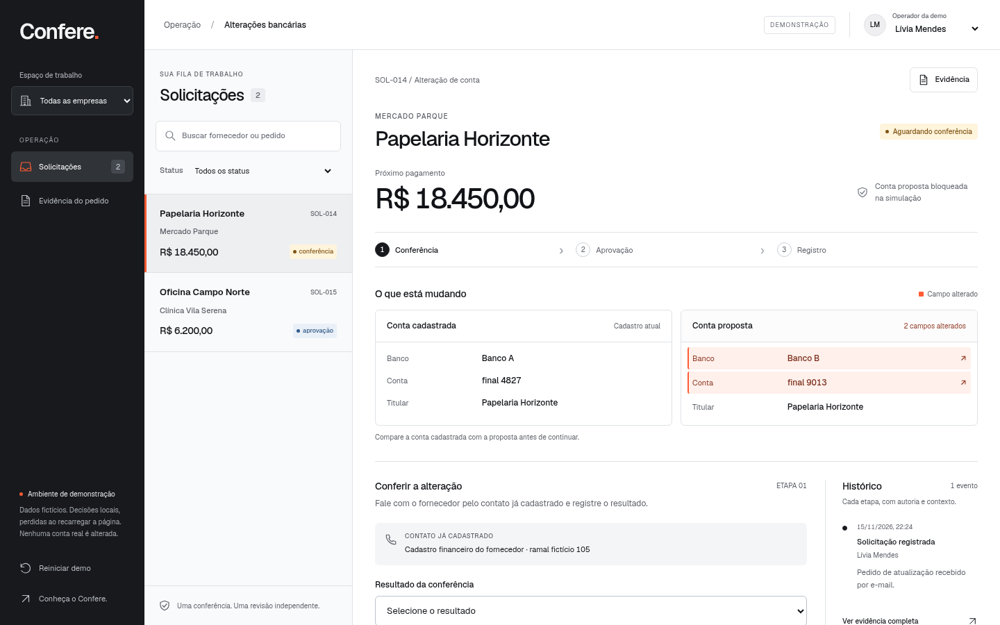
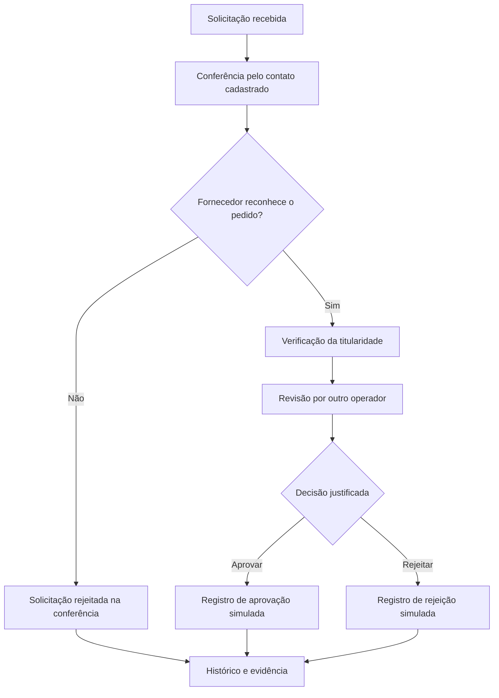
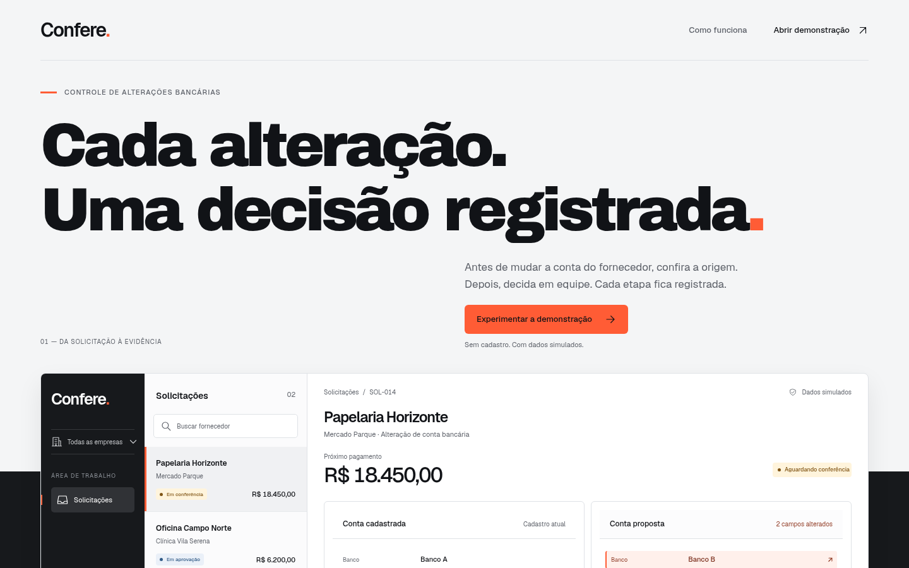
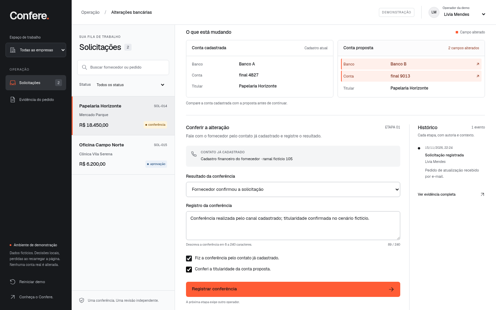
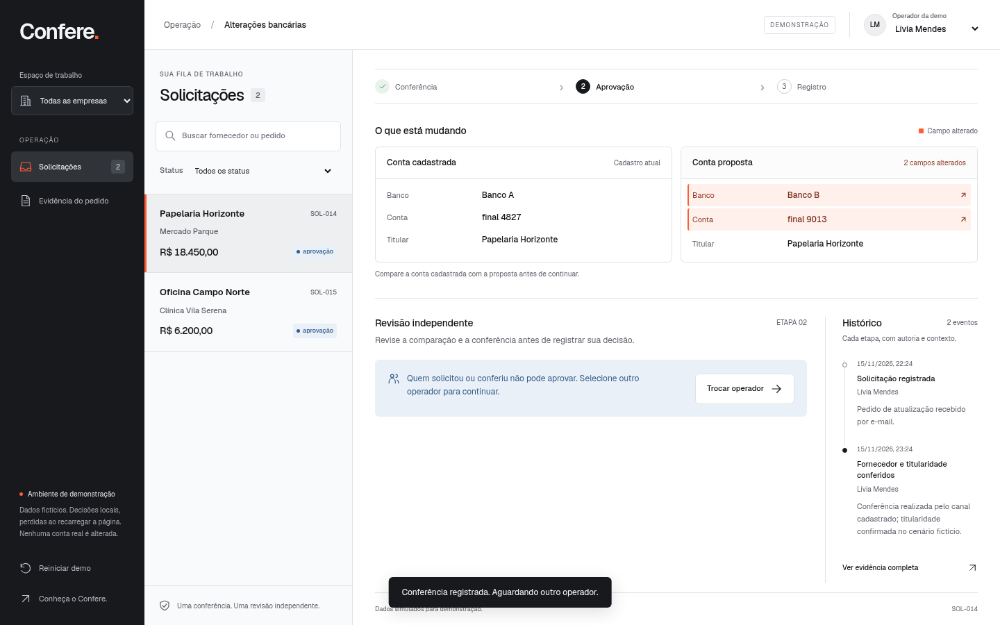
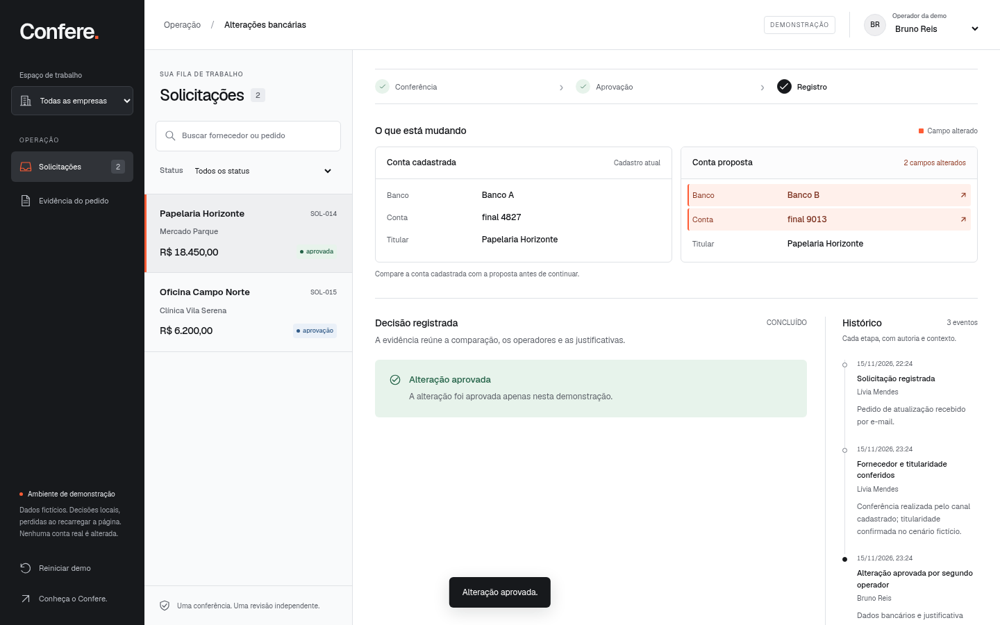
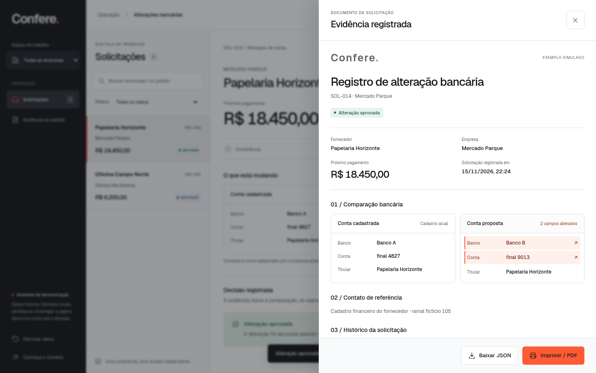
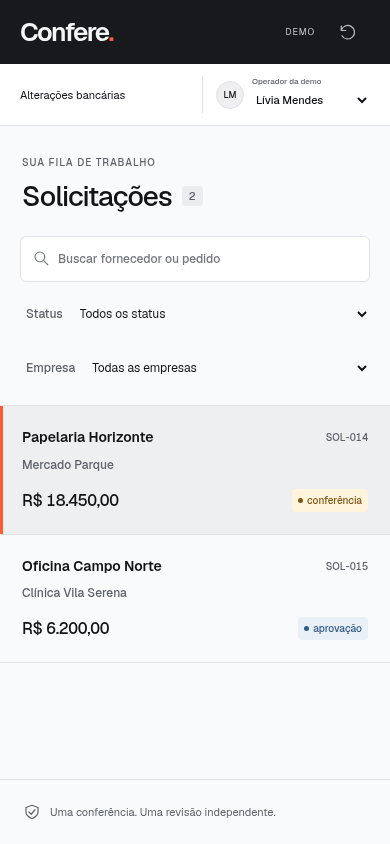

# Confere. — Controle de alterações bancárias de fornecedores

> **Projeto demonstrativo de portfólio.** Fluxo visual de conferência, revisão independente e registro de evidências de pedidos de alteração de dados bancários de fornecedores. **Todos os dados e operadores são fictícios.** Não existe integração bancária, autenticação real ou autorização de pagamentos.



[Veja a demonstração em vídeo](docs/video/confere-demo.mp4) · [Interface inicial](index.html) · [Sistema de demonstração](validacao-de-fornecedores.html)

## O problema

Alterações de contas de fornecedores são um ponto sensível do processo de contas a pagar: um pedido recebido por e-mail ou canal não verificado pode ser indevido. O objetivo desta prova de conceito é mostrar **como um fluxo de checagem pelo contato cadastrado, segregação de funções e documentação da decisão poderia ser apresentado na interface**.

## Funcionalidades implementadas

- Fila com **duas solicitações fictícias**, status, valores, identificação e filtros por empresa, status ou texto (inclusive busca sem acentos).
- Comparação lado a lado da conta cadastrada e da conta proposta, com destaque dos campos alterados.
- Registro da conferência do fornecedor pelo contato previamente cadastrado, com confirmação de titularidade quando a solicitação é reconhecida.
- Possibilidade de **contestar** uma solicitação ainda na conferência, sem encaminhá-la à aprovação.
- Etapa de **aprovação ou rejeição por segundo operador**: na lógica da demonstração, quem solicitou ou conferiu não pode aprovar.
- Histórico cronológico com operador, horário, justificativa e resultado registrado.
- Visualização da evidência, **exportação JSON** e opção de impressão/PDF pelo navegador.
- Interface responsiva para desktop e dispositivos móveis; reinício dos dados para repetir o fluxo.

### Como experimentar o fluxo

1. Abra a solicitação `SOL-014` (Papelaria Horizonte).
2. Com **Lívia Mendes**, selecione *Fornecedor confirmou a solicitação*, escreva uma justificativa (6–240 caracteres) e marque as duas conferências.
3. Registre a conferência. A aplicação exigirá outro operador para prosseguir.
4. Troque o seletor de operador para **Bruno Reis** ou **Camila Torres**; aprove ou rejeite com justificativa.
5. Abra **Evidência** para consultar o histórico, baixar o JSON ou imprimir em PDF.
6. Teste a `SOL-015`, já posicionada na etapa de revisão, e clique em **Reiniciar demo** para voltar ao início.

## Fluxo de negócio simulado



A troca de operador é **apenas uma simulação de segregação de funções na interface**. Um usuário pode selecionar qualquer nome; portanto, esta demonstração **não impõe um controle de segurança real**.

## Telas

| Tela | Prévia |
| --- | --- |
| Apresentação |  |
| Fila e comparação |  |
| Conferência |  |
| Revisão por outra pessoa |  |
| Decisão concluída |  |
| Evidência do processo |  |
| Mobile |  |

**[Assistir ao vídeo demonstrativo (MP4)](docs/video/confere-demo.mp4)** — sequência das telas reais do protótipo com destaque para cada mecanismo.

## Stack e estrutura

O projeto funciona como **aplicação estática**, sem necessidade de banco de dados, build ou instalação de dependências para o uso comum.

| Tecnologia | Uso |
| --- | --- |
| HTML5 + CSS3 | Página institucional, aplicação e layout responsivo |
| JavaScript (sem framework) | Fluxos, estados, filtros, acessibilidade e eventos |
| Node.js, `node:test` | Testes automatizados das regras de domínio |
| GitHub Actions | Validação sintática e testes a cada push/PR |

```text
index.html                         Página de apresentação
validacao-de-fornecedores.html    Aplicação demonstrativa
assets/data.js                    Dados fictícios e regras de negócio
assets/app.js                     Interface e interação do sistema
assets/marketing.js               Prévia e etapas da apresentação
assets/*.css                      Estilos da aplicação
assets/favicon.svg                Ícone do projeto
tests/domain.test.cjs              Testes automatizados
docs/screenshots/                 Capturas do sistema em uso
docs/video/                       Vídeo demonstrativo
.github/workflows/tests.yml       Pipeline de testes
```

As fontes Geist e Archivo Black são solicitadas ao Google Fonts por CSS, com fontes alternativas disponíveis em caso de indisponibilidade de rede.

## Executar localmente

```bash
# Na pasta do projeto
python3 -m http.server 8000
```

Abra `http://localhost:8000/` e clique em **Experimentar a demonstração**. A interface também pode ser aberta diretamente pelo arquivo HTML em navegadores compatíveis, mas um servidor local é recomendado.

### Testes

Use Node.js 18 ou superior:

```bash
npm test         # testes de regras de negócio
npm run check   # verificação de sintaxe + testes
```

As verificações incluem bloqueio de aprovação pela pessoa que solicitou ou conferiu, integridade do histórico ao rejeitar entradas inválidas, encerramento de solicitações, tratamento de campos alterados e proteção de saída HTML.

## Limitações e próximos passos

Este é um **protótipo front-end, não uma solução pronta para uso financeiro**:

- Os registros existem apenas na memória da página e **são perdidos quando ela é recarregada**. O botão de reiniciar também elimina as decisões simuladas.
- Não há autenticação, autorização vinculada a usuários reais, banco de dados, backend ou integração com ERP, pagamentos ou instituições financeiras.
- A conferência por telefone e a titularidade **são declarações inseridas pelo operador da demo**, sem checagem automática ou validação externa.
- A exportação JSON e o relatório impresso apresentam o histórico local; não são evidências assinadas, imutáveis ou juridicamente autenticadas.
- O valor de pagamento demonstrado serve para contextualização; **nenhum pagamento real é efetuado, autorizado ou bloqueado**.

Para uma versão de produção, seria necessário adotar identidade e permissões verificadas no servidor, trilha de auditoria persistente e protegida contra alterações, gestão de evidências/documentos, controles antifraude, integrações aprovadas e revisão de segurança, privacidade e requisitos regulatórios antes do uso.

## Sobre

Projeto de portfólio que explora **segregação de funções, prevenção a fraudes em alterações cadastrais, trilha de decisões e UX de sistemas internos**. O foco está na clareza do fluxo e nas validações da interface, sem apresentar controles simulados como proteção efetiva de sistemas financeiros.